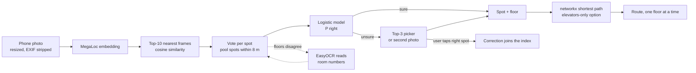

# Hound Around

**Never lost around here.** Snap a photo of where you're standing in Boston University's Center for Computing & Data
Sciences (CDS, 665 Commonwealth Ave). Hound Around recognizes the hallway and the floor, then routes you to your room,
with an elevators-only mode. Wrong? Tap the right spot and it learns.

Built at BU Spark! **DS+X 2026**, College Hack track.

| | |
| --- | --- |
| Live app (open on a phone) | **https://www.hound-around.tech** |
| Slide deck | [SLIDES LINK] |
| Setup and demo video | [VIDEO LINK] |
| Backend API | https://dribeiro0-hound-around.hf.space (`/health`) |

## Contents

[Problem](#the-problem) · [What it does](#what-it-does) · [How it works](#how-it-works) · [Data](#the-data) ·
[Data science methods](#data-science-methods) · [Results](#results) · [Ethics](#ethics-and-responsibility) ·
[Design](#design) · [Accessibility](#accessibility) · [Impact](#impact-and-whats-next) · [Tech stack and Kiro](#tech-stack-and-how-we-used-kiro) · [Setup](#setup) ·
[Repo layout](#repo-layout) · [Team](#team) · [Credits](#credits)

## The problem

GPS doesn't work indoors: a phone can tell you you're in a building, not which hallway or which floor. BU publishes
no indoor maps, and its [campus accessibility map](https://www.bu.edu/disability/campus-accessibility/) stops at
building entrances, so there are no published accessible indoor routes. CDS makes this worse: floors share the same
finishes near the elevators.

The people who pay for this are first-year students hunting for a room by number, visitors who have never been inside,
and wheelchair users who need a route without stairs. Google built indoor AR navigation for airports and malls (Indoor
Live View, 2021). Nobody built it for students.

We asked BU students about the worst time they got lost in a campus building. One answer sums it up:

> "I had an event in the GSU. I couldn't find the room, so I didn't go."
> (BU student, October 2026)

Being lost indoors doesn't just make people late; it makes them skip things. We spend about 90% of our lives indoors,
exactly where GPS fails.

## What it does

1. **Snap.** Take a photo down the hallway or at a room number. The phone shrinks it to 512 px and strips its metadata
   before upload.
2. **Locate.** The server matches it against 7,008 labeled hallway frames and returns the spot, the floor and a
   calibrated probability of being right, in about 0.6–0.7 s.
3. **Confirm.** When it's sure, it just answers. When it isn't, it shows its top 3 guesses or asks for a second photo
   facing another way. It never pretends to know.
4. **Route.** Pick a room (for example 164). You get the path drawn one floor at a time, with turn-by-turn text on
   tap. **Elevators only** removes every stair edge.
5. **Learn.** If the spot was wrong, the user taps the right one. That photo's vector joins the index under the right
   label, and the next photo at that spot comes back right.

Also: no camera or no signal? Type the room number you're next to and get directions without a photo.

## How it works



The photo itself is discarded right after it is embedded. Only the vector and the prediction are kept, so a
correction can be applied. The API contract every part was built against is in [`docs/contract.md`](docs/contract.md).

## The data

**No dataset of BU's interiors existed, so we built one during the hackathon.**

| | |
| --- | --- |
| Footage | 67 videos we filmed on site, Oct 23–24, 2026: 60 phone walks and one-spot clips, 7 Insta360 clips |
| Frames | 13,000 extracted at 2 fps; 8,537 kept after removing blurry (1,245), duplicate (59), unmapped (3,129) and restricted-area (30) frames |
| Search index | 7,008 frames, capped per spot so heavily filmed hallways don't dominate |
| Spots | 57 labeled spots on the three event floors: B1 (2,442 kept frames), F1 (3,534), F2 (2,561) |
| Labels | We walked each floor saying every spot's ID out loud; Whisper transcripts turned the callouts into labels, checked by hand |
| Map | A walkable graph (nodes at intersections, elevator and stair exits, entrances and room doors) traced from the floor plans in the building's public 2019 BPDA Draft Project Impact Report, then corrected on foot |
| Privacy | Faces blurred (OpenCV YuNet + MediaPipe) before any frame left the laptop it was processed on |

**How we identified it.** The question was "can one photo tell you where you are inside one building?" That needs
images of that building labeled by place, plus a map to route on. No public source had either, so we filmed the
hallways ourselves, and the only floor plans available were in a public city planning filing. We restricted filming
to the floors open to the event (B1, F1, F2) and to public circulation space.

**Splits.** We never test on frames from a video that is in the index (leave-one-video-out). Outsider test photos are
kept separate and never used for tuning.

The frames, floor plans, graph and index are **not in this repository** (see [Ethics](#ethics-and-responsibility)).
The dataset card is [`docs/dataset.md`](docs/dataset.md).

## Data science methods

- **Image retrieval with k-nearest-neighbor classification.** Each image becomes an 8,448-dimensional
  [MegaLoc](https://github.com/gmberton/MegaLoc) place-recognition descriptor. The 10 nearest index frames by cosine
  similarity vote for a spot; votes for spots within 8 m on the same floor pool together, since they lead to the same
  route.
- **Model selection by cross-validation.** Leave-one-video-out on 1,758 photos taken at a spot: color histograms,
  CLIP, DINOv2-small and MegaLoc, plus preprocessing variants (center crop vs. full frame, side-crop views, frames per
  spot). Code: [`ml/research/`](ml/research/README.md).
- **Logistic regression for calibrated confidence.** Five match features (vote confidence, vote share, top
  similarity, margin to the runner-up, whether the top 3 span floors) predict whether the answer is within 10 m on the
  right floor. Fit out-of-fold, leave-one-video-out ([`ml/calibration.py`](ml/calibration.py)). Two thresholds turn
  that probability into three behaviors: answer, top-3 picker, or ask for a second photo.
- **OCR as a second signal.** When the vote is split across floors, EasyOCR reads room numbers and floor numerals and
  re-ranks within that floor (BU room numbers encode the floor).
- **Online learning from corrections.** A confirmed correction adds that query's vector to the index with a higher
  vote weight. Measured on held-out footage: how often one correction fixes the next photo at that spot, and how often
  it hijacks a different spot.
- **Graph shortest path.** networkx over a weighted graph (meters, plus a time cost on elevator and stair edges);
  elevators-only mode drops stair edges, and unverified edges are excluded.

No large language model is in the recognition or routing loop.

## Results

All numbers below are measured, on our own footage, with whole videos held out of the index. They are not an
independent user study.

**Matcher comparison** (leave-one-video-out, n = 1,758 photos at a spot, plain top-10 vote):

| Matcher | Exact spot | Correct spot in top 3 | Right floor |
| --- | ---: | ---: | ---: |
| DINOv2-small, center crop (first version) | 28.6% | 52.7% | 74.2% |
| DINOv2-small, full frame + side-crop views | 36.9% | 59.4% | 81.3% |
| **MegaLoc, full frame (shipped)** | **48.2%** | **74.9%** | **89.4%** |

**The shipped flow** (MegaLoc + calibrated tiers, same 1,758 queries):

| | |
| --- | ---: |
| Photos answered automatically | 63.4% |
| …of which within 10 m on the right floor | 91.4% |
| Shown the top-3 picker | 22.8% |
| Asked for a second photo | 13.8% |
| Simulated user success (right spot after answer, picker or second photo) | 84.1% |
| Server `/locate` time on live phone photos | 0.6–0.7 s |

**What else we learned:**

- Color histograms and CLIP both scored below DINOv2; a place-recognition model (MegaLoc) beat general-purpose
  features by a wide margin.
- More frames from the same videos stopped helping past about 40 per spot. New filming sessions and new angles helped:
  B1 top-3 went from 28% to 53% going from one training video to two.
- The main errors are look-alike neighbors (the F2 east corridor) and B1 ↔ F2 confusion from lighting. Room-sign OCR
  and the top-3 picker are the safety net.
- One correction made the next photo of that spot right 83% of the time, and hijacked another spot 2.9% of the time
  (measured on the DINOv2 build).

**Limitations.** These numbers come from our own footage; a test on photos taken by people outside the team is the
next step (`python -m ml.eval --split test`, never used for tuning). One building, three floors. Footage was filmed at standing height over two days; seated users'
photos and other seasons are untested. Corrections reset when the server restarts unless persistent storage is
configured.

## Ethics and responsibility

*Statement (under 250 words):*

**Responsible data sourcing and use.** We filmed only public hallways of the floors open to the event, excluding
service corridors and security rooms. Floor plans come from a public 2019 BPDA filing, used only to build the routing
graph and never displayed. Frames, plans, graph and index stay in a private store: a complete
photo map of a building is a security risk, so this public repo holds code only.

**Privacy, bias and fairness.** Faces are blurred before any frame leaves the laptop it was processed on. User photos
are resized and stripped of metadata on the phone, then deleted after matching. No GPS, Wi-Fi positioning, accounts
or location history. Accuracy differs by floor and lighting, and we filmed at standing height, so wheelchair users'
photos may match worse; we report per-floor numbers and list this as untested. Elevators-only routing exists so the
people with the most to lose are served first.

**Potential harms and mitigation.** A wrong answer can send someone the wrong way, so low-confidence matches ask for a
choice or a second photo instead of guessing. Malicious corrections could poison the index: corrections are
rate-limited, and at scale they would require BU login and three agreeing users. Users see only their own path, never
a full map.

**Transparency and accountability.** The app tells users their photo is deleted and shows its uncertainty. This
README documents our data sources, methods, measured accuracy, evaluation protocol and limitations, and separates
internal numbers from outsider tests.

## Design

Built for someone standing in a hallway, phone in one hand, class about to start.

- **Four numbered steps** (Snap, Locate, Confirm, Route) stay visible at the top, so you always know where you are in
  the flow.
- **One accent color.** Near-black screens with red used only for "you are here" and your path, so the important
  thing is always the brightest thing on screen.
- **Your next step, never a map.** Directions come one card at a time ("Keep straight", "Turn left toward the
  restrooms"); a floor change gets its own full-screen card. The app never shows a full floor plan.
- **Uncertainty is visible.** When the match is unsure, the app says so and shows its top 3 as plain-language places
  ("Hallway outside Room 164"), not IDs or percentages.
- **Fallbacks at every step:** retake, second photo, or type the room number beside you.
- **Built for real phones:** photos shrink to 512 px before upload, a blur check asks you to retake a shaky photo, and
  the 3D building view respects reduced-motion settings.

## Accessibility

- **Elevators only** switch on the first screen; routes then avoid every stair edge, and property tests check that
  on every run.
- Manual start: type the room you're next to, no camera needed.
- Light and dark themes, a pause control for motion, and respect for reduced-motion settings.
- Large type for room numbers and the next step.

## Reliability

- Requests time out after 8 s with a retry, and are cancelled when you leave a screen, so the app never shows a stale
  result.
- Without its data the API answers 503 ("not ready") instead of inventing a location.
- Per-client rate limits on uploads and corrections; one worker, so a correction is live for the very next photo.
- CI runs the backend and frontend tests and blocks any commit containing private data.

## Impact and what's next

- **Who it helps:** first-years finding rooms by number, campus visitors, and wheelchair users who today have no
  published accessible indoor routes at BU.
- **Not just CDS.** Each building is a data package (frames, labels, graph, index), not new code: film it, label it,
  blur it, index it. Orientation leaders could cover BU's main academic buildings with a phone and our pipeline; no
  beacons or hardware.
- **It gets better with use.** Every confirmed photo joins the index, and spots where the model is unsure flag
  themselves for re-filming.
- **Partners at BU:** Disability & Access Services (accessible routes), Admissions and Orientation (tours and move-in),
  IS&T (the College Hack track partner).
- **Next:** run the matcher on the phone so it works with no signal; test with seated users and people outside the
  team; require BU login and three agreeing users before a correction changes the shared index.

## Tech stack and how we used Kiro

| Layer | Tools |
| --- | --- |
| Phone web app | React 18, Vite 5, Tailwind 4, deployed on Vercel |
| API | Python 3.11, FastAPI, Uvicorn, in Docker on Hugging Face Spaces |
| Recognition | PyTorch, MegaLoc (via torch.hub, pinned), NumPy, EasyOCR; DINOv2-small via Transformers as the fallback model |
| Routing | networkx |
| Data pipeline | ffmpeg, Whisper, OpenCV (YuNet), MediaPipe |
| Storage | private Hugging Face dataset (index, graph, rooms), SQLite (corrections) |
| Quality | pytest (172 backend tests), Node test runner (frontend), GitHub Actions with a private-file guard |

**Kiro.** We used Kiro for a spec ([`.kiro/specs/`](.kiro/specs/hound-around-completion/): requirements, design,
tasks), steering docs that turn our privacy rules into a per-change checklist ([`.kiro/steering/`](.kiro/steering/)),
and agent hooks: tests on save, an API-contract guard, a private-file guard on stop, and a frontend build check
([`.kiro/hooks/`](.kiro/hooks/)). Kiro built the first `ml/` package (embedder, OCR, index, evaluation with a leakage
guard), frontend wiring, and property-based tests: on 200 randomly generated graphs per run, an accessible route never
uses a stair edge ([`tests/test_properties.py`](tests/test_properties.py)). [`KIRO.md`](KIRO.md) separates what Kiro built from what was
written before or with other tools. We also used Claude Code for the pipeline, matching experiments and deployment.

## Setup

Python 3.11 for the backend and ML. Commands run from the repository root.

### Backend

```sh
python -m venv .venv
.venv/bin/python -m pip install -r requirements-dev.txt     # API + test deps, no model downloads
.venv/bin/python -m pytest -q                               # synthetic data only, no private files needed
.venv/bin/python -m uvicorn api.main:app --host 127.0.0.1 --port 8000 --workers 1
```

On Windows use `.venv\Scripts\python.exe`. Without private `data/graph.json`, `rooms.json` and `index.npz` the API
reports 503 ("not ready") rather than inventing a location. Details: [`api/README.md`](api/README.md).

### Recognition (needs the private data)

```sh
pip install torch==2.6.0 torchvision==0.21.0 --index-url https://download.pytorch.org/whl/cpu
pip install -r requirements.txt
HOUND_EMBEDDER=megaloc python -m ml.build_index            # data/*/labels.csv -> data/index.npz
python -m ml.eval --split test                             # outsider photos in data/test/
python -m ml.research.backend_eval --dataset data/dataset data/dataset_new data/dataset_f2
```

### Add your own building

Each building is its own data package (frames, labels, graph, index); no new code. Film each hallway once while
saying the spot's name out loud, then:

```sh
git clone https://github.com/DxubleBTW/Hound-Around && cd Hound-Around
python pipeline/extract_frames.py <video> --out data/frames --srt data/transcripts   # 2 fps frames + Whisper transcript
python pipeline/label_frames.py --frames data/frames --anchors data/anchors.json --nodes data/nodes.txt --out data/dataset
python pipeline/blur_faces.py data/dataset                                           # before anything leaves the laptop
python -m ml.build_index                                                             # data/index.npz
python -m uvicorn api.main:app --port 8000                                           # then: cd frontend && npm run dev
```

Full details, filming tips and thresholds: [`pipeline/README.md`](pipeline/README.md). The app's building picker and
per-building settings: [`docs/navigation-features-proposal.md`](docs/navigation-features-proposal.md).

### Frontend

```sh
cd frontend
npm ci
npm test
npm run dev        # http://localhost:5173, also on your LAN IP for a phone
```

With no `VITE_API_URL` set, the app runs on mock data (a "Demo data" pill shows). Set `VITE_API_URL` to the backend
URL for a real build; see [`frontend/README.md`](frontend/README.md).

### Deployment

- **Frontend:** Vercel builds `frontend/` from `main`.
- **Backend:** the root `Dockerfile` (`python:3.11-slim`, port 7860, non-root user) builds the API with CPU PyTorch
  and bakes the model weights in at build time (`--build-arg EMBEDDER=megaloc` for MegaLoc). At startup
  `scripts/start.sh` pulls a pinned snapshot (graph, rooms, index, confidence calibration) from a **private** Hugging
  Face dataset using an `HF_TOKEN` secret, so private files never enter the public Space or this repo. One Uvicorn
  worker, with `--proxy-headers` so the per-client rate limit works behind the Hugging Face proxy.
- [Recognition reliability and rollout](docs/recognition-reliability.md): versioned confidence, atomic package
  switching, bounded inference, correction retries that learn once, and privacy-preserving measurements. Missing
  calibration falls back to the picker; incompatible artifacts report not ready. Roll code and data back together.
- Corrections persist across restarts only if `HOUND_STATE_DIR` points at persistent storage; see
  [`docs/navigation-features-proposal.md`](docs/navigation-features-proposal.md).

## Repo layout

| Path | What |
| --- | --- |
| `api/` | FastAPI backend: `/health`, `/locate`, `/route`, `/correct` |
| `ml/` | Embedders, OCR, index, calibration, evaluation; `ml/research/` holds the experiments |
| `pipeline/` | Video → frames → labels → face blur, graph building |
| `frontend/` | React phone web app |
| `tests/` | Backend, ML and property tests (synthetic data only) |
| `docs/` | API contract, dataset card, status, role guides |
| `.kiro/` | Kiro spec, steering and hooks |
| `KIRO.md` | How Kiro was used |

## Team

| Name | Role |
| --- | --- |
| David Ribeiro | ML and data: matching, evaluation, filming and labeling pipeline |
| Jun Olea | Backend: API, routing, corrections, reliability |
| Avery Lee | Frontend and Kiro: phone app, spec, steering and hooks |
| Tobi | Data and workflow |
| Bryan Martinez | Pitch, design and testing |

All five of us worked on the pitch and design, verification, and regression testing through GitHub pull requests and
CI.

## Credits

- **MegaLoc** (Gabriele Berton and Carlo Masone): the place-recognition model we ship.
- **DINOv2** (Meta AI) and **CLIP** (OpenAI): compared in our experiments; DINOv2 is the fallback model.
- **EasyOCR** (Jaided AI), **Whisper** (OpenAI), **OpenCV YuNet** and **MediaPipe** face detection.
- Floor plans: BU Data Sciences Center, BPDA Draft Project Impact Report, Vol. 1 (KPMB Architects, April 2019).
  Used only to build the private routing graph.
- Prior art that shaped the approach: [InLoc](https://arxiv.org/abs/1803.10368) (retrieval-first indoor
  localization), Apple Maps' privacy design for visual localization, and [PIGEON](https://arxiv.org/abs/2307.05845)
  as the cautionary case for photo geolocation.
- Thanks to BU Spark! and the DS+X organizers.
